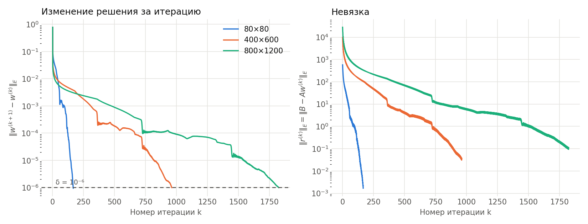
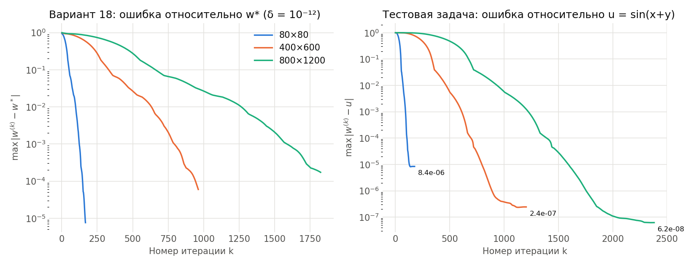

# Этап 1. OpenMP-программа (вариант 18)

Задача: приближённо решить −Δu = 1 в области D = {−1 < x, y < 1} ∖ {(x−1)² + (y−1)² ≤ 1}
с условием u = sin(x + y) на границе. Метод фиктивных областей в квадрате Π = (−1, 1)²,
ε = h², разностная схема (12), метод сопряжённых градиентов с диагональным
предобуславливателем, остановка ‖w^(k+1) − w^(k)‖_E < δ = 10⁻⁶.

## Файлы

| Файл | Что это |
|---|---|
| `problem.h` | геометрия области, точная площадь пересечения клетки с D, коэффициенты (11) |
| `solver.h` | сетка, заполнение коэффициентов, метод сопряжённых градиентов (OpenMP) |
| `solver.cpp` | программа: аргументы, замер времени, вывод, дамп решения и истории итераций |
| `test.cpp` | тесты, `make test` |
| `Makefile` | сборка: `make POLUS=1` на Polus, `make` на Mac (brew g++); `make test` |
| `table1.lsf` | LSF-задача для таблицы 1: serial-база и все конфигурации, по два раза |
| `make_table.py` | строит таблицу и график ускорения из вывода Polus |
| `make_figures.py` | рисунки: решение, сравнение сеток, сходимость w(0,0), эффект привязки нитей |
| `build_report.sh` | пересобирает таблицы, рисунки и PDF-отчёт одной командой |
| **`report/report.pdf`** | **краткий отчёт по этапу** (исходник `report/report.tex`) |
| `results/table1.md`, `results/table1.csv` | таблица 1 и сравнение на 80×80 |
| `results/speedup_omp.png` | график ускорения |
| `results/binding.png` | ускорение без привязки нитей и с привязкой |
| `results/solution.png`, `results/solution_grids.png` | решение на 800×1200 и на четырёх сетках |
| `results/grid_convergence.png` | w(0,0) при сгущении сетки |
| `results/iterations.png` | ‖w(k+1) − w(k)‖ и невязка по итерациям |
| `results/error_iterations.png` | ошибка по итерациям: относительно w* (δ = 1e-12) и относительно точного решения тестовой задачи |
| `results/history/` | история итераций (текст), из неё строятся два графика выше |
| `runs/a1 … a4` | история попыток: код, LSF-задача, вывод Polus, README с разбором |
| `runs/table1` | вывод прогона для таблицы 1 (задача 1611313, попытка 4, узел polus-c2) |
| `runs/table1_a3` | прогон таблицы попыткой 3 (задача 1600380, узел polus-c4) |
| `runs/table1_first` | первый прогон таблицы (задача 1600375, без 400×600/32 и 800×1200/2) |

Последовательная версия, с которой сравнивается OpenMP, — `../01_serial` (попытка 4).

## Как распараллелено

- Пять циклов по узлам сетки — подготовка коэффициентов, старт CG и три цикла внутри итерации
  (A·p; обновление w и r; новое направление p) — размечены `#pragma omp parallel for`.
  Строки сетки i делятся между нитями поровну (статическое расписание по умолчанию).
- Скалярные произведения (z, r), (Ap, p), (p, p) считаются через `reduction(+:…)`:
  у каждой нити своя частичная сумма, OpenMP складывает их в конце цикла.
- Итерации CG идут последовательно (каждая зависит от предыдущей); α, β и проверка
  остановки считаются одной нитью между параллельными циклами.
- Нити привязаны к ядрам через `GOMP_CPU_AFFINITY`: каждая нить — на первый аппаратный поток
  своего ядра (у ядра POWER8 их 8). Узел запрашивается целиком (`#BSUB -x`, 16 ядер).
  При 32 нитях — по две нити на ядро.

## Тесты

`make test` (вывод на Mac — `runs/a4/tests.mac.txt`), все 13 проходят:

| Что проверяется | Результат |
|---|---|
| площадь: весь квадрат, угол [0,1]², левая половина, клетка внутри круга | 4 − π/4, 1 − π/4, 2, 0 — точно до 1e-15 |
| площадь: сумма по клеткам 80×80; 0 ≤ S_ij ≤ h1·h2 | 4 − π/4, ошибка 1e-13 |
| эталон 20/40/80 | 44, 85, 167 итераций, w(0,0) как у независимой реализации |
| точное решение u = sin(x+y) | ошибка 1.34e-4, 3.36e-5, 8.43e-6 — падает в 4 раза при удвоении сетки |
| фиктивная область: \|w − v0\| в узлах с S_ij = 0 | 2.0e-4, 1.2e-5, 7.8e-7 |
| 1, 2, 4, 8 нитей | одинаковые итерации, max \|w_T − w_1\| = 2e-15 |
| история итераций | одна запись на итерацию, остановка при ‖Δw‖ < δ |

## Сходимость по итерациям

```bash
./solver 800 1200 --history h.txt                       # ‖w(k+1) − w(k)‖_E и ‖r(k)‖_E
./solver 800 1200 1e-12 --dump ref.bin                  # эталон w*
./solver 800 1200 --history h.txt --ref ref.bin         # + ошибка относительно w*
./solver 800 1200 1e-10 --exact --history h.txt         # тестовая задача, ошибка относительно u
```




При δ = 1e-6 итерационная ошибка в норме C: 7.6e-6 (80×80), 6.0e-5 (400×600), 1.7e-4 (800×1200).
На тестовой задаче ошибка выходит на уровень ошибки схемы: 8.4e-6, 2.4e-7, 6.2e-8.

## Проверка правильности (80×80, Polus, узел polus-c2)

Последовательная программа: 167 итераций, 0.0182 с, w(0,0) = 0.241097385417.

| Нити | Итерации | Время, с | Ускорение | w(0,0) | Отличие от serial |
|---|---|---|---|---|---|
| 1 | 167 | 0.0181 | 1.00 | 0.241097385417 | 0 |
| 4 | 167 | 0.0064 | 2.85 | 0.241097385417 | 0 |
| 16 | 167 | 0.0153 | 1.19 | 0.241097385417 | 0 |

Решение совпадает с последовательным до всех выведенных знаков на любом числе нитей.
На сетке 80×80 мало работы (79 строк), поэтому накладные расходы на запуск и синхронизацию
нитей заметны: 16 нитей медленнее 4.

## Таблица 1. Результаты расчётов на IBM Polus (OpenMP)

Задача 1611313, узел polus-c2 целиком, итоговая версия (попытка 4). Время — минимум из двух
запусков, ускорение = время serial / время OpenMP на той же сетке в том же задании.

| Нити | Сетка M×N | Итерации | Время, с | Ускорение |
|---|---|---|---|---|
| 2 | 400×600 | 962 | 1.8741 | 2.06 |
| 4 | 400×600 | 962 | 0.9455 | 4.07 |
| 8 | 400×600 | 962 | 0.4911 | 7.85 |
| 16 | 400×600 | 962 | 0.3170 | 12.15 |
| 32 | 400×600 | 962 | 0.3447 | 11.18 |
| 2 | 800×1200 | 1824 | 14.1422 | 2.07 |
| 4 | 800×1200 | 1824 | 7.0917 | 4.12 |
| 8 | 800×1200 | 1824 | 3.5805 | 8.16 |
| 16 | 800×1200 | 1824 | 1.9253 | 15.17 |
| 32 | 800×1200 | 1824 | 1.7314 | 16.87 |

Время последовательной программы на polus-c2: 400×600 — 3.8525 с, 800×1200 — 29.2048 с.

Узел polus-c2 примерно в 1.65 раза медленнее polus-c4: прошлый прогон таблицы попыткой 3 на c4
(`runs/table1_a3`) дал serial 2.33 и 17.65 с. Ускорение при этом то же: на c4 ×12.9 и ×15.0 на
16 нитях, на c2 ×12.2 и ×15.2.


## Выводы

- До 16 нитей ускорение близко к линейному: ×12.2 на 400×600 и ×15.2 на 800×1200.
  На большей сетке больше работы на нить, поэтому доля накладных расходов меньше.
- 32 нити на 16 ядрах (по две на ядро) на 800×1200 дают ×16.9 против ×15.2, а на 400×600
  замедляют: ×11.2 против ×12.2. Вторая нить делит с первой вычислительные блоки и кэш ядра,
  метод упирается в пропускную способность памяти, а на меньшей сетке добавочные расходы
  на синхронизацию 32 нитей перевешивают.
- Без привязки нитей к ядрам на 16 нитях было лишь ×4.9 (попытка 2) — нити делили ядра
  между собой.
- Узлы различаются по скорости (c2 медленнее c4 в 1.65 раза), поэтому время сравнимо только
  в пределах одного узла; serial-база всегда меряется в том же задании, что и OpenMP.
- Каждая конфигурация считается дважды, в таблицу идёт минимум: в одном из прогонов был выброс
  1.71 с вместо 1.18 с.

## История попыток

| Попытка | Что сделано | Результат на Polus |
|---|---|---|
| [a1](runs/a1/README.md) | `parallel for` на всех циклах, суммы без `reduction` | гонка данных: на 4 и 16 нитях метод не сходится |
| [a2](runs/a2/README.md) | `reduction` для скалярных произведений | верно, но на 400×600 ускорение лишь ×4.9 на 16 нитях |
| [a3](runs/a3/README.md) | привязка нитей к ядрам, узел целиком | ×12.5 на 16 нитях |
| [a4](runs/a4/README.md) | код разделён на problem.h/solver.h/solver.cpp, тесты, история итераций | итоговая версия |

История последовательной версии — `../01_serial/runs/a1 … a4`.

## Как запустить на Polus

Подробные инструкции по всем запускам — в `../README.md`.
