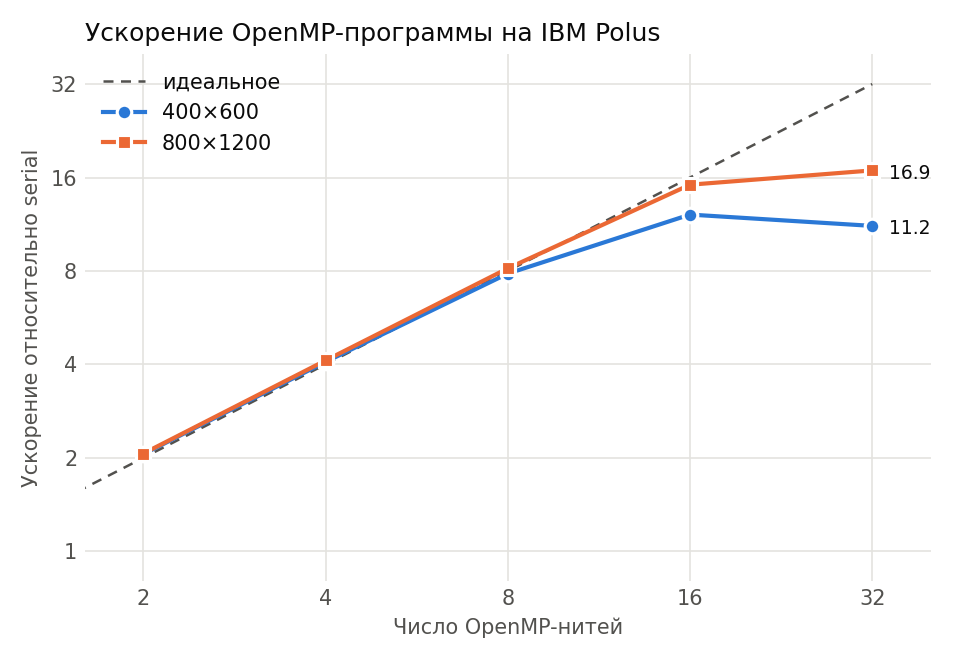

# Этап 1. OpenMP-программа (вариант 18)

Задача: приближённо решить −Δu = 1 в области D = {−1 < x, y < 1} ∖ {(x−1)² + (y−1)² ≤ 1}
с условием u = sin(x + y) на границе. Метод фиктивных областей в квадрате Π = (−1, 1)²,
ε = h², разностная схема (12), метод сопряжённых градиентов с диагональным
предобуславливателем, остановка ‖w^(k+1) − w^(k)‖_E < δ = 10⁻⁶.

## Файлы

| Файл | Что это |
|---|---|
| `solver.cpp` | итоговая OpenMP-программа |
| `Makefile` | сборка: `make POLUS=1` на Polus, `make` на Mac (brew g++) |
| `table1.lsf` | LSF-задача для таблицы 1: serial-база и все конфигурации, по два раза |
| `make_table.py` | строит таблицу и график ускорения из вывода Polus |
| `make_figures.py` | рисунки: решение, сравнение сеток, сходимость w(0,0), эффект привязки нитей |
| `build_report.sh` | пересобирает таблицы, рисунки и PDF-отчёт одной командой |
| **`report/report.pdf`** | **краткий отчёт по этапу** (исходник `report/report.tex`) |
| `results/table1.md`, `results/table1.csv` | таблица 1 и сравнение на 80×80 |
| `results/speedup_omp.png` | график ускорения |
| `results/binding.png` | ускорение без привязки нитей и с привязкой |
| `results/solution.png`, `results/solution_grids.png` | решение на 800×1200 и на четырёх сетках |
| `results/convergence.png` | w(0,0) при сгущении сетки |
| `runs/a1 … a3` | история попыток: код, LSF-задача, вывод Polus, README с разбором |
| `runs/table1` | вывод прогона для таблицы 1 |

Последовательная версия, с которой сравнивается OpenMP, — `../01_serial` (попытка 4).

## Как распараллелено

- Пять циклов по узлам сетки — подготовка коэффициентов, старт CG и три цикла внутри итерации
  (A·p; обновление w и r; новое направление p) — размечены `#pragma omp parallel for`.
  Строки сетки i делятся между нитями поровну (статическое расписание по умолчанию).
- Скалярные произведения (z, r), (Ap, p), (p, p) считаются через `reduction(+:…)`:
  у каждой нити своя частичная сумма, OpenMP складывает их в конце цикла.
- Итерации CG идут последовательно (каждая зависит от предыдущей); α, β и проверка
  остановки считаются одной нитью между параллельными циклами.
- Нити привязаны к ядрам через `GOMP_CPU_AFFINITY`: каждая нить — на первый аппаратный поток
  своего ядра (у ядра POWER8 их 8). Узел запрашивается целиком (`#BSUB -x`, 16 ядер).
  При 32 нитях — по две нити на ядро.

## Проверка правильности (80×80, Polus)

| Нити | Итерации | Время, с | Ускорение к serial | w(0,0) | Отличие от serial |
|---|---|---|---|---|---|
| serial | 167 | 0.0110 | — | 0.241097385417 | — |
| 1 | 167 | 0.0110 | 1.01 | 0.241097385417 | 0 |
| 4 | 167 | 0.0042 | 2.63 | 0.241097385417 | 0 |
| 16 | 167 | 0.0066 | 1.66 | 0.241097385417 | 0 |

Решение совпадает с последовательным до всех выведенных знаков на любом числе нитей.
На сетке 80×80 мало работы (79 строк), поэтому накладные расходы на запуск и синхронизацию
нитей заметны: 16 нитей медленнее 4.

## Таблица 1. Результаты расчётов на IBM Polus (OpenMP)

Время — минимум из двух запусков, ускорение = время serial / время OpenMP на той же сетке.

| Нити | Сетка M×N | Итерации | Время, с | Ускорение |
|---|---|---|---|---|
| 2 | 400×600 | 962 | 1.1316 | 2.06 |
| 4 | 400×600 | 962 | 0.5770 | 4.03 |
| 8 | 400×600 | 962 | 0.3114 | 7.47 |
| 16 | 400×600 | 962 | 0.1763 | 13.20 |
| 4 | 800×1200 | 1824 | 4.3328 | 4.07 |
| 8 | 800×1200 | 1824 | 2.2426 | 7.87 |
| 16 | 800×1200 | 1824 | 1.1786 | 14.98 |
| 32 | 800×1200 | 1824 | 1.0389 | 16.99 |

Время последовательной программы: 400×600 — 2.3266 с, 800×1200 — 17.6548 с.

## Выводы

- До 16 нитей ускорение близко к линейному: ×13.2 на 400×600 и ×15.0 на 800×1200.
  На большей сетке больше работы на нить, поэтому доля накладных расходов меньше.
- 32 нити на 16 ядрах (по две на ядро) дают только ×17.0 против ×15.0: вторая нить делит
  с первой вычислительные блоки и кэш ядра, а метод упирается в пропускную способность памяти.
- Без привязки нитей к ядрам на 16 нитях было лишь ×4.9 (попытка 2) — нити делили ядра
  между собой.

## История попыток

| Попытка | Что сделано | Результат на Polus |
|---|---|---|
| [a1](runs/a1/README.md) | `parallel for` на всех циклах, суммы без `reduction` | гонка данных: на 4 и 16 нитях метод не сходится |
| [a2](runs/a2/README.md) | `reduction` для скалярных произведений | верно, но на 400×600 ускорение лишь ×4.9 на 16 нитях |
| [a3](runs/a3/README.md) | привязка нитей к ядрам, узел целиком | ×12.5 на 16 нитях; итоговая версия |

История последовательной версии — `../01_serial/runs/a1 … a4`.

## Как запустить на Polus

Подробные инструкции по всем запускам — в `../README.md`.
